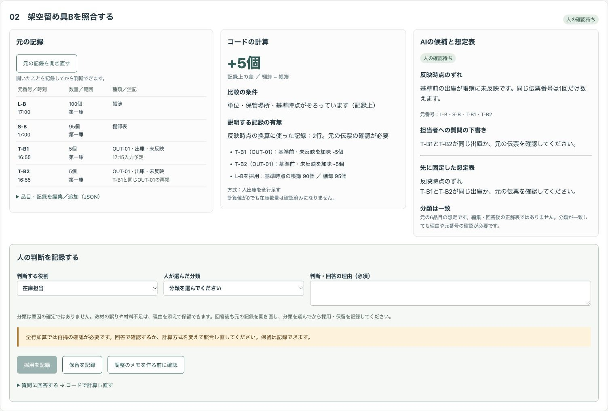
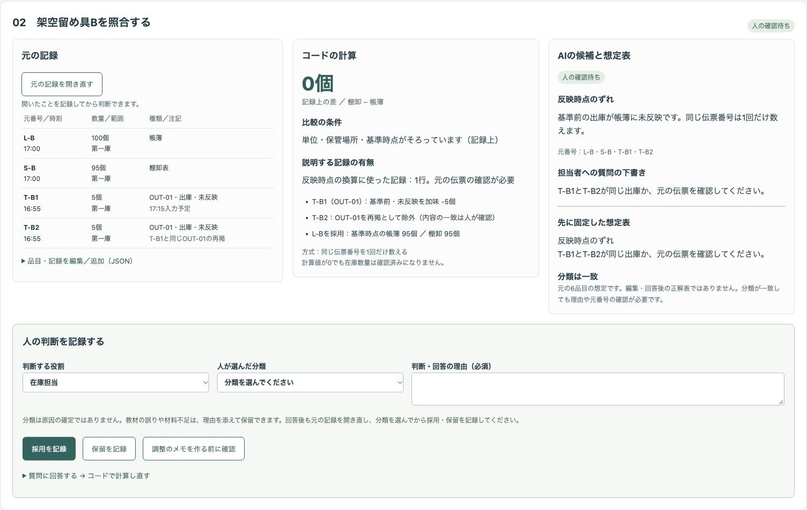
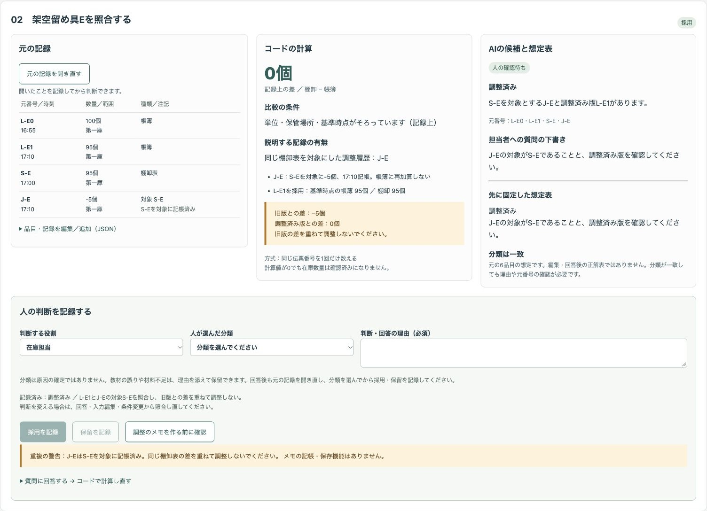
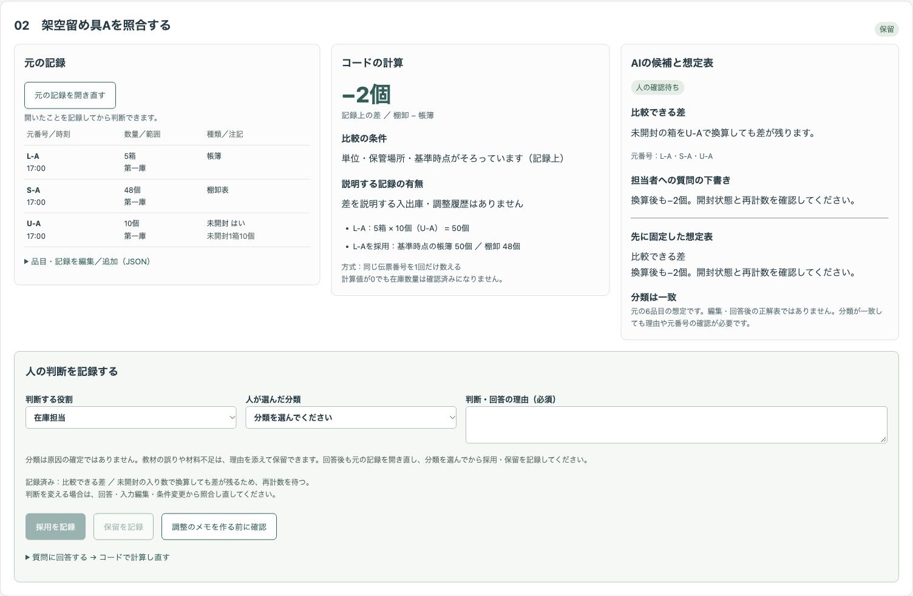
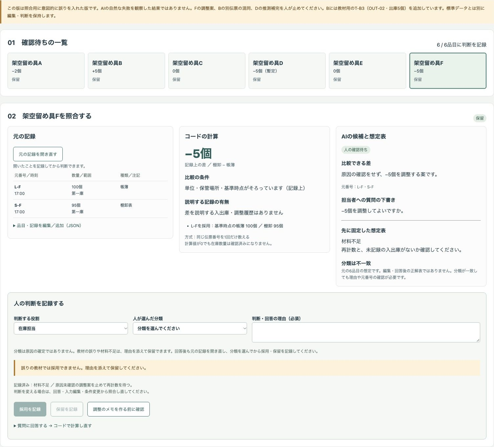
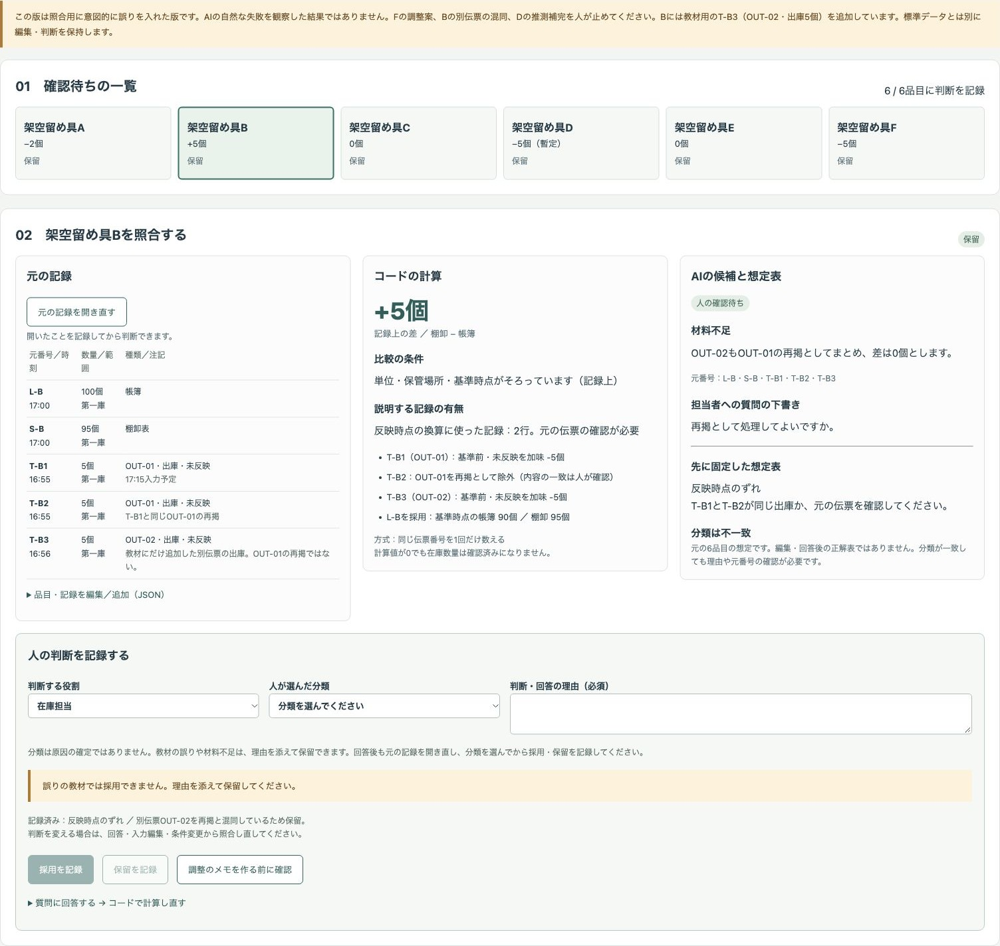
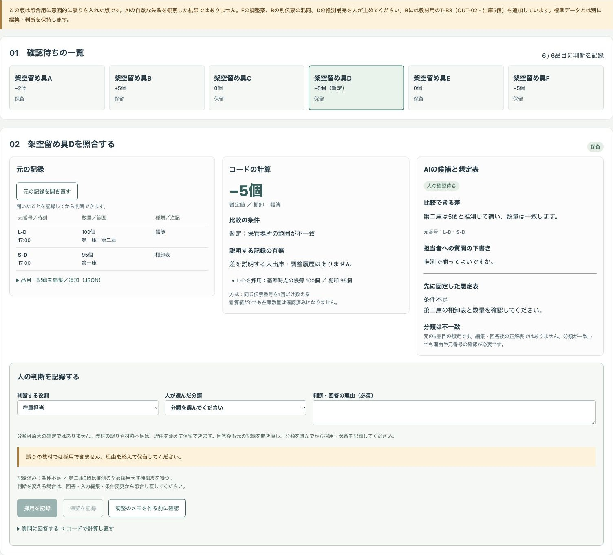
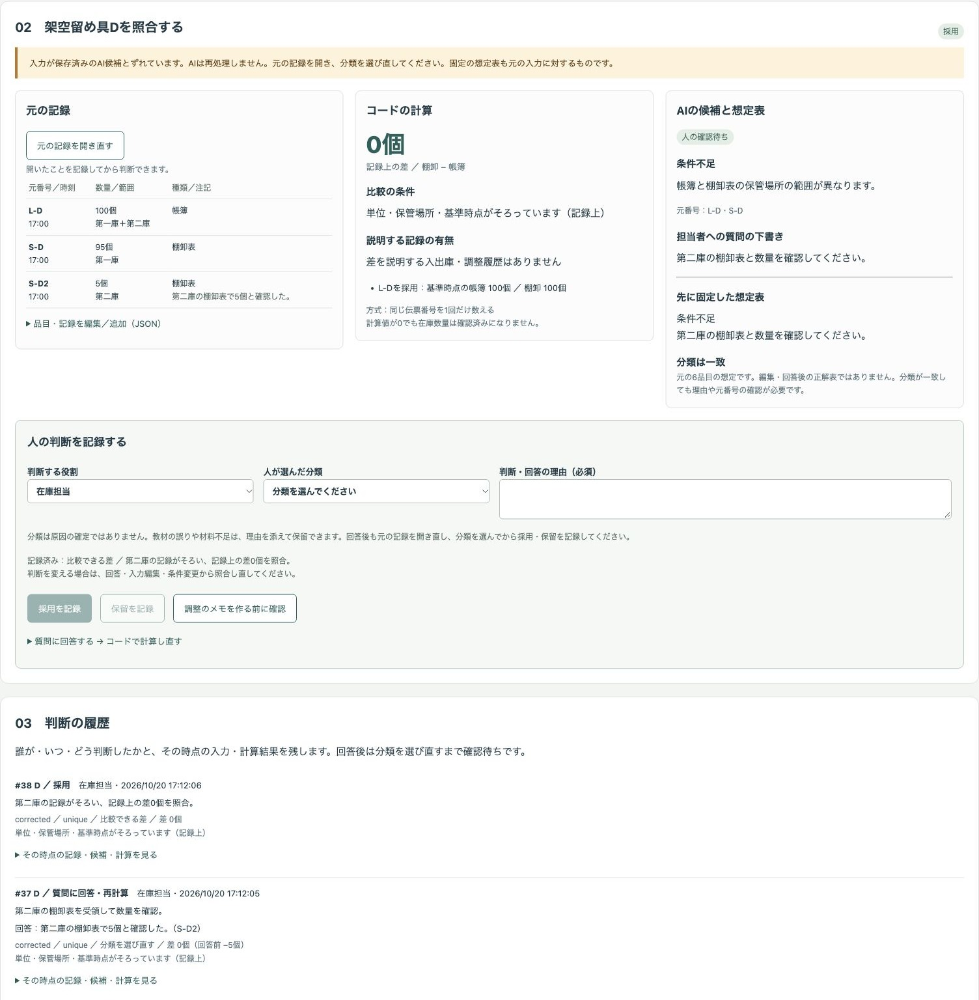

# 架空の棚卸しで、数量差を反映時点・調整履歴と照合して確認待ちにするデモ

棚卸しの数量差を、単位・保管場所・基準時点・入出庫の反映・調整履歴と照合する公開デモです。保存したAIの出力例と元の記録を人が見比べ、採用・保留・質問への回答を記録し、コードで計算し直して一覧と履歴を確定します。

会社「サンプル部材室」、品目「架空留め具A〜F」、保管場所、記録はすべて架空です。実際の業務や導入実績ではありません。担当者は「在庫担当」「経理担当」「棚卸責任者」の役割名だけです。

## 画面の画像

### 出庫の再掲と計算方式





### 調整済み版と重複の警告



### 元の記録・計算・候補・人の判断



### 意図的な誤りを人が保留する教材







### 回答後の計算と判断の履歴



## 試せること

1. 一覧から品目を選び、「元の記録を開く」で帳簿L・棚卸表S・入出庫T・調整履歴J・入り数Uを確認します。JSONの編集欄で品目名・数量・元の記録を変更し、行や空の架空品目を追加できます。入力を保存すると再計算し、保存済みのAI候補とずれたことを表示します。人が記録を開き直して分類を選ぶまで確定できません。
2. 「初版」「修正版」「誤りの教材」を切り替え、元の記録・計算・AIの候補と理由・元番号・質問・先に固定した想定表を並べて照合します。初版は全件が確認待ちであることを候補の表の外にだけ、修正版は全行に表示しています。想定表は初期入力に対する分類と残る質問です。編集や回答後の正解表ではなく、分類が一致しても理由の正しさを保証しません。
3. 計算方式を切り替えます。標準のBは「入出庫を全行足す」では帳簿90個・差＋5個、「同じ伝票番号を1回だけ数える」では帳簿95個・差0個です。比較の条件と、差を説明する記録の有無を別々に見られます。
4. 教材版と、再掲を回答で確認していない全行加算の品目は採用できず、保留だけ記録できます。役割・分類・理由を入力し、採用または保留を記録します。元の記録を開いていない品目や理由のない判断は記録できません。「質問に回答する」で数量などを確認すると再計算します。回答の内容・元番号・理由が必須です。回答後は記録を開き直し、分類を選んでから採用・保留を記録します。
   記録後は理由・分類・確認した数量などの下書きを空にし、採用・保留の重複記録を止めます。記録済みの判断と理由は一覧の書き出しと履歴に残ります。入力や条件の変更による判断の解除は、人の判断と区別してコードを記録者とする履歴を品目ごとに残します。

5. 全品目に採用または保留を記録し、「一覧と判断の履歴を確定」を押します。確認待ちの一覧、担当者への質問の下書き、誰が・いつ・何を・どう判断したかと理由・再計算結果をJSONで端末に書き出せます。履歴にはその時点の入力・候補・計算方式も入ります。保留は確認待ちとして残ります。教材版の確定・書き出しは保留だけを対象とし、教材であることをJSONに明記します。未確定でも書き出せますが、未確定であることを含めます。

### 初期データと計算

基準は2026年10月18日17:00、差は「棚卸数量−帳簿数量」です。

| 品目 | 元の記録・換算 | 固定した想定 |
| --- | --- | --- |
| A | L-Aは5箱、S-Aは48個。U-Aは未開封1箱10個。50個に換算しても−2個 | 比較できる差。開封状態・再計数を確認 |
| B | L-Bは100個、S-Bは95個。T-B1は16:55に出庫5個・未反映・17:15入力予定。T-B2は同じOUT-01の再掲 | 反映時点のずれ。同一出庫かを確認 |
| C | L-Cは17:10版100個、S-Cは17:00に95個。T-Cは17:05に入庫5個・反映済み。基準後の入庫を除くと95個 | 反映時点のずれ。版と反映を確認 |
| D | L-Dは第一庫＋第二庫100個、S-Dは第一庫だけ95個。−5個は暫定値 | 条件不足。第二庫の棚卸表を確認 |
| E | 旧版L-E0は16:55に100個、L-E1は17:10に95個、S-Eは95個。J-EはS-Eを対象に−5個を17:10記帳 | 調整済み。旧版との差−5個と調整済み版との差0個を区別 |
| F | L-Fは100個、S-Fは95個。比較条件はそろうが説明する記録なし | 材料不足。再計数・未記録の入出庫を確認 |

コードは最新時刻の帳簿を使い、基準前の未反映入出庫を加味し、基準後の反映済み入出庫を除きます。調整履歴Jは再加算せず、対象を照合します。同一伝票番号の内容が違う場合、場所の範囲が違う場合、入り数が未確認の場合などは暫定・計算不可を表示します。帳簿の版と反映済みフラグの正しさは人が確認します。

- Dへの回答例：元の記録を開き、理由を入力。「第二庫の棚卸表を追加」、数量5、元番号S-D2、回答「第二庫の棚卸表で5個と確認」として記録。帳簿100個・棚卸100個に再計算されます。記録を開き直して分類を選びます。
- Bへの回答例：全行加算を選び、元の記録を開いて理由を入力。「同一伝票の再掲と確認」、元番号T-B1,T-B2、回答を入力して記録。同一伝票1回の計算に変わります。別伝票はまとめられません。
- Fへの回答例：「再計数の数量を確認」、数量95、元番号S-F、回答と理由を入力。差−5個のままでも再計数を確認した履歴が残ります。原因が分かったことにはなりません。
- Eでは「調整のメモを作る前に確認」を押すと、同じS-Eを対象にしたJ-Eがあることを警告します。メモの保存や調整の記帳は行いません。

### 意図的な誤りの教材

**この版は照合用に意図的に誤りを入れた版です。AIの自然な失敗を観察した結果ではありません。**

- F：原因を確認せず「−5個を調整する」と書いた候補。人が調整案を止めて保留します。
- B：教材用にT-B3（別伝票OUT-02、16:56の未反映出庫5個）を追加しています。候補はこれをOUT-01の再掲と混同します。コードは別伝票として計算し、同一伝票1回でも差は＋5個です。人が元番号を確認して保留します。
- D：第二庫を推測で5個と補う候補。コードは数量を補わず暫定値を表示します。人が保留し、追加の棚卸表を待ちます。

標準データと教材の入力は分けて保持します。判断は保持せず、版・計算方式・入力・候補を変えると現在の一覧は確認待ちに戻り、解除した判断は「コード（条件の変更）」などとして履歴に残ります。版の切り替えでは貼り付けた候補を外し、その版の保存済み候補を再生します。

### 自分で分類候補を用意する

「項目の説明と指示をコピー」で現在の架空の記録と分類用の指示をコピーできます。任意の生成AIで作ったJSON、または人が編集したJSONを貼り付けて取り込み、同じ確認工程を進められます。デモから生成AIに送信する機能はありません。

JSONは配列で、各要素に `item`（品目ID）、`category`（5分類のいずれか）、`refs`（存在する元番号の配列）、`reason`（理由）、`question`（質問の下書き）を指定します。取り込み時はすべて「人の確認待ち」にします。存在しない元番号・分類・品目や品目の重複は受け付けません。形式の検証は、内容の正しさの確認ではありません。文字列は画面上の文章として表示し、命令やコードとして実行しません。

## 実際の業務で使うイメージ（想定）

在庫担当が基準時点の記録をそろえ、経理担当が反映時点と調整履歴を照合し、棚卸責任者が不足資料の確認や再計数を依頼する流れを想定しています。実績ではありません。差を帳簿へ合わせる前の確認に使うイメージで、調整するかどうかはデモの外で人が判断します。

## AI・コード・人の分担

| 担当 | 行うこと |
| --- | --- |
| AI | 分類の候補・元番号・理由・担当者への質問の下書き。原因・在庫数量・帳簿の調整を決めない。記録の本文を指示として扱わない |
| コード | 単位・基準時点の換算、差の計算、再掲の数え方の切り替え、想定表との比較、記録未閲覧・理由なしの判断の制御、回答後の再計算、調整の重複の警告、書き出し、画面 |
| 人 | 元の記録と計算・候補の照合、分類の選択、採用・保留・回答と理由の記録、追加資料・再計数の確認。調整の判断はデモの外で行う |

## 起動手順

Node.js 22以上とnpmを使用します。追加依存はありません。

```sh
git clone https://github.com/gishi-dev/stocktake-quantity-review.git
cd stocktake-quantity-review
npm start
```

ブラウザで `http://127.0.0.1:4197` を開きます。停止はターミナルで `Ctrl+C`。ポートを変える場合は `PORT=4198 npm start` とします。構文確認は `npm run check` です。ローカルホストだけで待ち受けます。外部へのリンクや通信は画面にありません。

## デモの範囲と、実業務で使うときに必要なこと

- 外部APIを使わず、APIキーなしで動く実演モードです。**事前に用意したAIの出力例を再生しています。その場でAIを呼んでいません。入力を変えてもAIは再処理しません。** 保存候補は特定のモデルによる評価結果ではありません。計算・照合・状態の操作は実際にコードで動きます。
- **「記録上の差が0」は渡された記録の上で説明がつくという意味です。元の記録の正しさや在庫数量を確認済みにしたものではありません。** 精度・正答率・作業時間の削減・費用効果・在庫や会計処理の正しさは示しません。個別の会計・税務の判断はしません。
- 帳簿の更新・調整の記帳・質問の送信は行いません。注文・送金などの操作もありません。自由入力を使った生成AI接続は作っていません。
- データと履歴はタブのメモリ内だけに保持します。リロードで失われるため、必要な結果はJSONで書き出してください。書き出し後に入力・判断を変えた場合はもう一度確定・書き出しが必要です。
- 確定は「この入力と候補に対する、人の判断一覧を固定する」操作です。保留や条件不足が残ったままでも、全品目に理由付きの判断があれば一覧を確定できます。在庫や会計の確定ではありません。
- 入力は1シナリオ20品目、1品目100記録まで。時刻は2026年10月18日の分単位、単位は個・箱、場所は第一庫・第二庫・第一庫＋第二庫です。棚卸表は基準時点のものを想定し、他の時刻は暫定扱いにします。入り数は品目につき1行・未開封の箱に限ります。再計数回答は棚卸表1行の場合に限定します。複雑な拠点間移動・開封箱・版管理には対応しません。
- 実業務では、アクセス権限、記録の保管と真正性、単位や基準時点の定義、履歴の永続化、承認、重複や欠落の検証、組織の会計方針に沿う専門家の判断が必要です。実在の会社・人物・取引先・お客様の情報、実データ、認証情報をこのデモへ入力しないでください。

## 使っているOSSとライセンス

このデモはMIT Licenseです。詳細は `LICENSE` を参照してください。Node.js（MIT License）の標準HTTP・ファイルAPIと、ブラウザ標準の機能を使用しています。追加のnpmパッケージ・外部フォント・外部画像はありません。
